<div align="center">



[](https://itskrishnamalhotra-stack.github.io/portfolio/)
[](https://itskrishnamalhotra-stack.github.io/portfolio/Krishna_Malhotra_Applied_AI_Resume.pdf)
[](https://itskrishnamalhotra-stack.github.io/portfolio/Krishna_Malhotra_Full_Stack_Resume.pdf)
[](https://www.linkedin.com/in/i-krishna-malhotra/)
[](mailto:its.krishnamalhotra@gmail.com?subject=Project%20enquiry%20for%20Krishna%20Malhotra)

</div>

## I build the whole path from workflow to product

I am a Delhi-based **applied AI and full-stack developer** building production software across agent workflows, APIs, business operations and modern web interfaces. My strongest work combines product ownership with hands-on engineering: mapping the workflow, building the system, testing it and shipping it.

| Evidence | What it demonstrates |
|---|---|
| **294 automated tests** in KAOSLY AI | Reliability across agent and application workflows |
| **129 application and API routes** in KAOSLY | Full-stack product scale across social, media and monetisation features |
| **QR ticketing, POS and operations** for Dolphin Waterpark | Software built around a real operating business |
| **Python, TypeScript and Firebase systems** | Delivery across backend services, product interfaces and cloud data |

## Selected systems

### [KAOSLY AI](https://github.com/itskrishnamalhotra-stack/kaosly-ai-source)

Cross-platform AI workspace with agent workflows, approval-gated tools, browser/native execution boundaries and 294 automated tests. **[Read the engineering case study](projects/kaosly-ai.md).**

### [KAOSLY](https://github.com/itskrishnamalhotra-stack/KAOSLY-Case-Study)

Creator platform built with Next.js and Firebase across 129 application and API routes, WebRTC experiences, monetisation workflows and Gemini/Genkit AI flows.

### [Dolphin Waterpark Operations](https://github.com/itskrishnamalhotra-stack/Dolphin-Waterpark-Case-Study)

QR-enabled ticketing, point of sale, staff workflows, billing and operational reporting designed for a live venue.

<details>
<summary><strong>More engineering work</strong></summary>

- **[UniConnect](https://github.com/itskrishnamalhotra-stack/UniConnect-university-management-system)** — Role-based university management application built with Flask.
- **[Threat Recognition System](https://github.com/itskrishnamalhotra-stack/Threat-Recognition-System)** — Computer-vision security prototype for recognising weapons and violent activity in video.
- **[Multi-Character Lip-Sync Engine](https://github.com/itskrishnamalhotra-stack/Multi-Character-Dialogue-Lip-Sync-Engine)** — Multi-face tracking, independent lip-sync inference and video compositing.

</details>

## Engineering toolkit

```text
Languages       Python · JavaScript · TypeScript · SQL
Product web     Next.js · React · Flask · Node.js · Tailwind CSS
Cloud and data  Firebase · Firestore · Cloud Functions · Redis · SQLite
Applied AI      Gemini · Genkit · RAG · BM25 · Whisper · PyTorch
Delivery        REST APIs · Authentication · CI/CD · Testing · Production debugging
```

## Current direction

I am interested in **applied AI, Python backend, full-stack product engineering and technical collaborations** where I can own meaningful parts of a product and ship working software.

## Education

- **Master of Computer Applications**, USICT, GGSIPU — August 2026 to present; expected August 2028
- **Bachelor of Computer Applications**, Maharaja Surajmal Institute — 2022–2025, 7.81/10 CGPA, First Division

> Commercial implementations remain private where required. Public source and sanitised case studies document the engineering decisions and outcomes.

